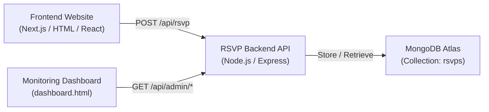
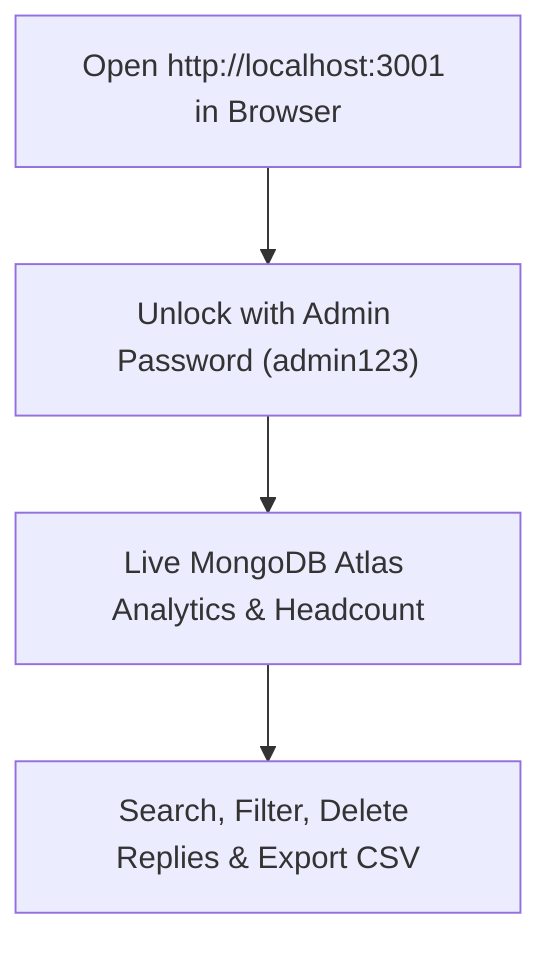
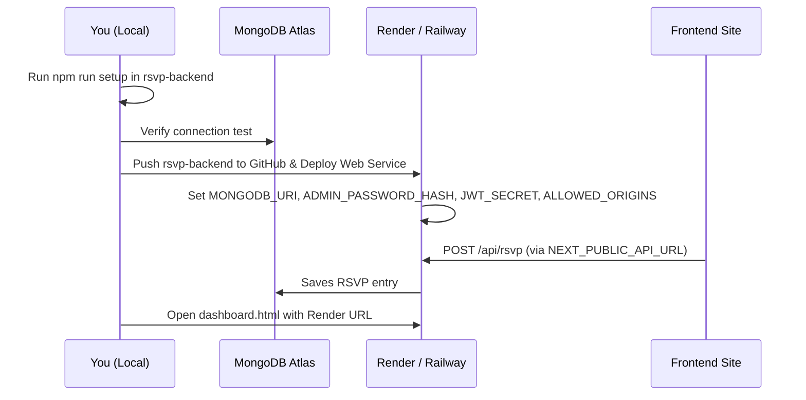

# RSVP Backend: Frontend Integration Implementation Plan

This implementation plan provides step-by-step instructions and drop-in code templates to integrate the `rsvp-backend` into any website or frontend framework (Plain HTML/JavaScript, React, Next.js, Vite, or static website builders).

---

## 1. Architecture & API Contract

The backend is completely decoupled from any specific frontend. Any client that can make a standard HTTP `POST` request can submit RSVPs.



### The API Contract (`POST /api/rsvp`)

- **URL**: `{API_BASE_URL}/api/rsvp`
- **Method**: `POST`
- **Headers**: `Content-Type: application/json`
- **Payload Schema**:

```json
{
  "name": "Ananya Sharma",
  "attending": true,
  "guests": 2,
  "message": "Looking forward to celebrating with you!",
  "website": ""
}
```

| Field | Type | Required | Rules & Validation |
|---|---|---|---|
| `name` | string | **Yes** | 2 to 80 characters, trimmed |
| `attending` | boolean | **Yes** | `true` (attending) or `false` (declined) |
| `guests` | number | Conditional | 1 to 10 if attending; automatically `0` if declining |
| `message` | string | No | Optional, maximum 300 characters |
| `website` | string | No | **Honeypot field**: Keep hidden with CSS. Must be empty for real guests. If filled, the backend silently drops the bot submission. |

### API Responses

| Status Code | Meaning | Example Response |
|---|---|---|
| `201 Created` | Successful submission | `{"success": true, "message": "RSVP confirmed successfully!", "data": {...}}` |
| `400 Bad Request` | Validation failure | `{"success": false, "message": "Name must be between 2 and 80 characters."}` |
| `429 Too Many Requests` | Rate limit triggered | `{"success": false, "message": "Too many RSVP requests from this connection..."}` |
| `500 Server Error` | Database/Server error | `{"success": false, "message": "An error occurred while saving your RSVP."}` |

---

## 2. Integration by Frontend Type

### Scenario A: Plain HTML + Vanilla JavaScript (Static Invitations)

For single-page HTML invitations (like `index.html` or existing static invitation files):

#### 1. HTML Form Markup
```html
<form id="weddingRsvpForm" onsubmit="submitWeddingRsvp(event)">
  <!-- Bot honeypot (keep hidden from users) -->
  <div style="display: none;" aria-hidden="true">
    <input type="text" id="rsvpHoneypot" name="website" tabindex="-1" autocomplete="off">
  </div>

  <!-- Name -->
  <div>
    <label for="rsvpName">Your Name *</label>
    <input type="text" id="rsvpName" required minlength="2" maxlength="80" placeholder="Enter your full name">
  </div>

  <!-- Attendance -->
  <div>
    <label>Will you attend? *</label>
    <label>
      <input type="radio" name="attendance" value="yes" checked onchange="toggleGuestField(true)">
      I will attend
    </label>
    <label>
      <input type="radio" name="attendance" value="no" onchange="toggleGuestField(false)">
      Sorry, I can't make it
    </label>
  </div>

  <!-- Number of Guests -->
  <div id="guestsGroup">
    <label for="rsvpGuests">Number of Guests (including you)</label>
    <input type="number" id="rsvpGuests" min="1" max="10" value="1">
  </div>

  <!-- Message -->
  <div>
    <label for="rsvpMessage">Message to the Couple</label>
    <textarea id="rsvpMessage" maxlength="300" placeholder="Leave a warm blessing..."></textarea>
  </div>

  <!-- Submit Button -->
  <button type="submit" id="rsvpSubmitBtn">Confirm RSVP</button>

  <!-- Status / Feedback Messages -->
  <div id="rsvpFeedback" style="display: none;"></div>
</form>
```

#### 2. JavaScript Submission Logic
```javascript
// Configure your backend API URL here:
const RSVP_API_URL = "http://localhost:5000"; // Or https://your-backend.onrender.com

function toggleGuestField(isAttending) {
  const guestsGroup = document.getElementById("guestsGroup");
  if (guestsGroup) {
    guestsGroup.style.display = isAttending ? "block" : "none";
  }
}

async function submitWeddingRsvp(event) {
  event.preventDefault();

  const submitBtn = document.getElementById("rsvpSubmitBtn");
  const feedback = document.getElementById("rsvpFeedback");

  const name = document.getElementById("rsvpName").value.trim();
  const attending = document.querySelector('input[name="attendance"]:checked').value === "yes";
  const guests = attending ? parseInt(document.getElementById("rsvpGuests").value, 10) : 0;
  const message = document.getElementById("rsvpMessage").value.trim();
  const website = document.getElementById("rsvpHoneypot").value; // Honeypot

  // Client-side validation
  if (!name || name.length < 2) {
    showFeedback("Please enter your name (at least 2 characters).", "error");
    return;
  }

  // Loading state
  submitBtn.disabled = true;
  submitBtn.textContent = "Confirming...";
  feedback.style.display = "none";

  try {
    const response = await fetch(`${RSVP_API_URL}/api/rsvp`, {
      method: "POST",
      headers: { "Content-Type": "application/json" },
      body: JSON.stringify({ name, attending, guests, message, website }),
    });

    const data = await response.json();

    if (!response.ok) {
      if (response.status === 429) {
        throw new Error("You have submitted multiple responses. Please wait a few moments.");
      }
      throw new Error(data.message || "Unable to confirm RSVP.");
    }

    // Success Screen / Feedback
    if (attending) {
      showFeedback(`Thank you, ${name}! We can't wait to celebrate with you.`, "success");
    } else {
      showFeedback(`Thank you for letting us know, ${name}. You will be dearly missed!`, "info");
    }

    // Reset form
    document.getElementById("weddingRsvpForm").reset();
    toggleGuestField(true);
  } catch (err) {
    showFeedback(err.message || "Network error. Please try again.", "error");
  } finally {
    submitBtn.disabled = false;
    submitBtn.textContent = "Confirm RSVP";
  }
}

function showFeedback(text, type) {
  const el = document.getElementById("rsvpFeedback");
  el.textContent = text;
  el.className = `feedback-message feedback-${type}`;
  el.style.display = "block";
}
```

---

### Scenario B: React / Next.js / Vite Applications

For modern component-based frontends, keep all network interaction in a reusable service function:

#### 1. API Helper (`lib/rsvpApi.ts` or `src/services/rsvp.js`)
```typescript
export interface RsvpPayload {
  name: string;
  attending: boolean;
  guests: number;
  message?: string;
  website?: string;
}

const API_BASE_URL =
  process.env.NEXT_PUBLIC_API_URL ||
  import.meta.env?.VITE_API_URL ||
  "http://localhost:5000";

export async function submitRsvp(payload: RsvpPayload) {
  const res = await fetch(`${API_BASE_URL}/api/rsvp`, {
    method: "POST",
    headers: { "Content-Type": "application/json" },
    body: JSON.stringify({
      ...payload,
      guests: payload.attending ? payload.guests : 0,
    }),
  });

  const json = await res.json();

  if (!res.ok) {
    const error: any = new Error(json.message || "Failed to submit RSVP");
    error.status = res.status;
    throw error;
  }

  return json;
}
```

#### 2. React Hook or Component Usage
```tsx
import { useState } from "react";
import { submitRsvp } from "./lib/rsvpApi";

export function RsvpCard() {
  const [name, setName] = useState("");
  const [attending, setAttending] = useState(true);
  const [guests, setGuests] = useState(1);
  const [message, setMessage] = useState("");
  const [website, setWebsite] = useState(""); // Honeypot
  const [status, setStatus] = useState<"idle" | "loading" | "success" | "error">("idle");
  const [errorMsg, setErrorMsg] = useState("");

  const handleSubmit = async (e: React.FormEvent) => {
    e.preventDefault();
    setStatus("loading");
    setErrorMsg("");

    try {
      await submitRsvp({ name, attending, guests, message, website });
      setStatus("success");
    } catch (err: any) {
      setStatus("error");
      setErrorMsg(err.message || "Something went wrong.");
    }
  };

  if (status === "success") {
    return (
      <div className="thank-you-card">
        <h3>Thank you, {name}!</h3>
        <p>{attending ? "We look forward to seeing you!" : "Thank you for letting us know."}</p>
      </div>
    );
  }

  return (
    <form onSubmit={handleSubmit}>
      {/* Honeypot */}
      <input
        type="text"
        value={website}
        onChange={(e) => setWebsite(e.target.value)}
        className="hidden"
        tabIndex={-1}
      />

      <input
        type="text"
        value={name}
        onChange={(e) => setName(e.target.value)}
        placeholder="Your Name"
        required
      />

      <button type="button" onClick={() => setAttending(true)}>I will attend</button>
      <button type="button" onClick={() => setAttending(false)}>Can't make it</button>

      {attending && (
        <input
          type="number"
          min="1"
          max="10"
          value={guests}
          onChange={(e) => setGuests(Number(e.target.value))}
        />
      )}

      <textarea
        value={message}
        onChange={(e) => setMessage(e.target.value)}
        placeholder="Message"
      />

      {errorMsg && <p className="error">{errorMsg}</p>}

      <button type="submit" disabled={status === "loading"}>
        {status === "loading" ? "Confirming..." : "Confirm"}
      </button>
    </form>
  );
}
```

---

## 3. Connecting the Next.js RSVP Dashboard

The monitoring dashboard is a modern Next.js / React application located in:
`dashboard/`



### Setup & Usage:
1. Start the backend: `cd backend && npm start` (runs on `http://localhost:5000`)
2. Start the dashboard: `cd dashboard && npm run dev` (runs on `http://localhost:3001`)
3. Open `http://localhost:3001` on PC or Mobile:
   - **PC View**: Wide data table, hover delete actions, live activity area chart & donut chart.
   - **Mobile View**: Touch-optimized guest cards, bottom slide-out full reply drawer, touch-friendly toolbar.
4. Enter your **Admin Password**: `admin123`
5. The dashboard automatically syncs with MongoDB Atlas every 12 seconds and supports real-time search, sorting, filtering, and 1-click CSV export.

---

## 4. Deployment Steps



### Backend Deployment (Render or Railway)
1. In your cloud provider (Render, Railway, etc.), create a **New Web Service** pointing to the `rsvp-backend` folder.
2. Build command: `npm install`
3. Start command: `npm start`
4. Set Environment Variables:
   - `MONGODB_URI`: Connection string from your Atlas cluster.
   - `ADMIN_PASSWORD_HASH`: Generated hash from `npm run setup`.
   - `JWT_SECRET`: Random 64-character secret.
   - `ALLOWED_ORIGINS`: Your frontend URL(s) (e.g. `https://my-wedding.vercel.app` or `*`).

---

## 5. Verification Checklist

- [ ] **Health Check**: `GET {API_URL}/api/health` returns `status: "ok"`.
- [ ] **Valid RSVP Submission**: Submitting a guest with 2 guests returns `201 Created`.
- [ ] **Declined Submission**: Submitting `"attending": false` records with `guests: 0`.
- [ ] **Validation Limits**: Empty name or message exceeding 300 characters returns friendly error (`400`).
- [ ] **Honeypot Filter**: Filling the `website` field returns 201 without saving spam in the database.
- [ ] **Duplicate Warning**: Submitting two replies with the same name flags a `"Duplicate Name"` badge on the dashboard.
- [ ] **CSV Export**: Clicking **Download CSV** opens a clean spreadsheet with correct columns and Unicode support.
